  

  <a href="https://yasirdemo.pythonanywhere.com">Portfolio</a> ·
  <a href="https://www.linkedin.com/in/yasir-ziyaudeen-ahamed/">LinkedIn</a> ·
  <a href="https://x.com/YasirBuildz">X</a> ·
  <a href="mailto:yasirsza@gmail.com">yasirsza@gmail.com</a>

  

### Shipped

- **[Marcus Intelligence](https://marcusai.in)**, co-founder and AI engineer. Autonomous QA agent: an LLM drafts browser tests, a grounding step rejects any step that isn't on the real page, a policy layer blocks risky actions like payments, and Playwright runs the rest.
- **Production RAG assistant at Martech AI**, used by 10,000+ students at a university client.

### Selected work

  
  
  
  
  
  

  

**Stack:** Python, FastAPI, TypeScript, Next.js, PostgreSQL, Playwright, LangGraph, OpenAI, Docker.

Won 4 hackathons, including Airia (Abu Dhabi). Open to AI engineer, forward-deployed and founding engineer roles.
